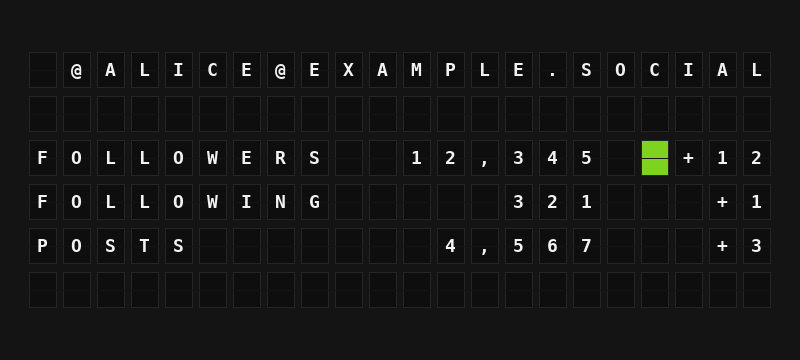

# Mastodon Stats Plugin

Show follower, following and post counts for any Mastodon account, with how much they changed today.



**→ [Setup Guide](./docs/SETUP.md)**

## Overview

The Mastodon Stats plugin looks up one Mastodon account with the instance's public account lookup (`GET /api/v1/accounts/lookup`, Mastodon 3.4.0 and later) and turns its follower, following and post counts into board-ready variables, in full (`12,345`) and short (`12.3K`) forms.

There is no sign-in: type the account as `@username@instance`. If your instance refuses public lookups, paste an access token with the `read:accounts` scope made on your own instance. The plugin can also show how much each count has changed since the start of the day.

## Template Variables

### Account

| Variable | Description | Example |
|----------|-------------|---------|
| `{{mastodon_stats.handle}}` | The account as @username@instance | `@ALICE@EXAMPLE.SOCIAL` |
| `{{mastodon_stats.username}}` | Username without the instance | `ALICE` |
| `{{mastodon_stats.display_name}}` | Profile display name (emoji dropped) | `ALICE EXAMPLE` |
| `{{mastodon_stats.instance}}` | The instance the account lives on | `EXAMPLE.SOCIAL` |
| `{{mastodon_stats.last_post}}` | Date of the most recent post | `OCT 1` |

### Counts

| Variable | Description | Example |
|----------|-------------|---------|
| `{{mastodon_stats.followers}}` | Followers, with thousands separators | `12,345` |
| `{{mastodon_stats.following}}` | Accounts followed | `321` |
| `{{mastodon_stats.posts}}` | Posts | `4,567` |
| `{{mastodon_stats.followers_short}}` | Followers, shortened | `12.3K` |
| `{{mastodon_stats.following_short}}` | Accounts followed, shortened | `321` |
| `{{mastodon_stats.posts_short}}` | Posts, shortened | `4.6K` |
| `{{mastodon_stats.followers_count}}` | Followers as a plain number | `12345` |
| `{{mastodon_stats.following_count}}` | Accounts followed as a plain number | `321` |
| `{{mastodon_stats.posts_count}}` | Posts as a plain number | `4567` |

### Daily Change

| Variable | Description | Example |
|----------|-------------|---------|
| `{{mastodon_stats.followers_change}}` | Change in followers today | `+12` |
| `{{mastodon_stats.following_change}}` | Change in accounts followed today | `+1` |
| `{{mastodon_stats.posts_change}}` | Change in posts today | `+3` |
| `{{mastodon_stats.followers_trend_tile}}` | Green tile when followers went up today, red when down | `{66}` |

## Example Templates

**Dashboard (Flagship):**

```
{{mastodon_stats.handle}}

FOLLOWERS {{mastodon_stats.followers}} {{mastodon_stats.followers_trend_tile}}{{mastodon_stats.followers_change}}
FOLLOWING {{mastodon_stats.following}} {{mastodon_stats.following_change}}
POSTS {{mastodon_stats.posts}} {{mastodon_stats.posts_change}}
```

**Compact (Note):**

```
@{{mastodon_stats.username}}
{{mastodon_stats.followers_short}} FOLLOWERS
{{mastodon_stats.followers_trend_tile}}{{mastodon_stats.followers_change}} TODAY
```

## Configuration

| Setting | Type | Required | Default | Description |
|---------|------|----------|---------|-------------|
| `enabled` | boolean | No | `false` | Turn the plugin on |
| `account` | string | Yes | | The account as `@username@instance`. A profile URL such as `https://mastodon.social/@alice` also works |
| `access_token` | string | No | | Only for instances that refuse public lookups. A token with `read:accounts` from your own instance |
| `show_daily_change` | boolean | No | `true` | Work out the change since the first check of the day |
| `refresh_seconds` | integer | No | `900` | How often to ask the instance (300-86400) |

No environment variables.

## Features

- Any account on any Mastodon instance (3.4.0 or later), no sign-in or app registration
- Optional access token for instances that require authentication, sent only to that instance
- Counts in full, shortened and as plain numbers for your own formatting
- Daily change for followers, following and posts, plus a green or red trend tile. The day starts from the last count seen the day before; the baseline is kept in memory, so it starts over after FiestaBoard restarts
- Hidden counts (some servers report them as negative) show as blank instead of a wrong number
- Custom emoji shortcodes and characters the board cannot show are dropped from display names
- Respects the instance's `Retry-After` when rate limited and keeps showing the last counts meanwhile
- Clear errors for an unknown account (`404`), a suspended account (`410`), an instance that needs a token, and a rejected token
- Works on every board shape: Flagship, Note, and Note arrays

## Author

FiestaBoard Team
